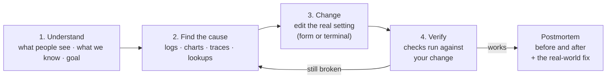
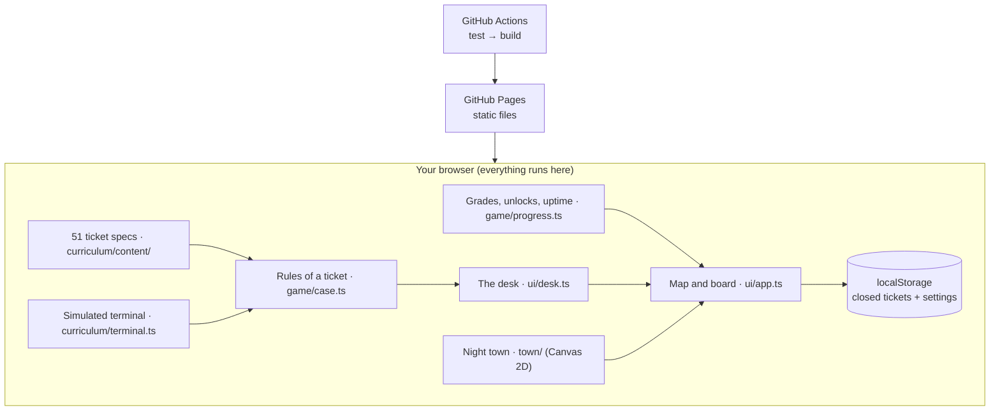

<div align="center">

# Ninefold: night shift

### Learn DevOps, SRE and cloud engineering by keeping a small town's lights on

*The town runs like a production system. Ships are containers, letters are packets, and tonight you carry the pager.<br>Find the evidence, make one change, prove it worked, then see the same fix with real tools.*

<a href="https://sharatvikas.github.io/ninefold/"></a>

[](https://github.com/sharatvikas/ninefold/actions/workflows/deploy.yml)


<a href="https://sharatvikas.github.io/ninefold/"></a>

<sub>The town is the status page. Windows light up as tickets close, a red beacon hangs over every district with an open ticket, and the bell tower glows with the town's nines.</sub>

**[Play now](https://sharatvikas.github.io/ninefold/)** · [Why Ninefold?](#why-ninefold) · [How a ticket works](#how-a-ticket-works) · [All 51 tickets](#the-town-9-districts-51-tickets) · [Glossary](#glossary) · [Run it locally](#run-it-on-your-own-computer)

</div>

---

## Why Ninefold?

Reliability work (DevOps, Site Reliability Engineering, cloud and platform engineering) is mostly learned **on the job, during real outages, on real production systems**. That's stressful, risky, and hard to practise on purpose.

Ninefold is a safe place to practise. The town *is* a running system:

- every **district** is one area of the job (networking, CI/CD, Kubernetes, security and so on)
- every **keeper** owns a service and pages you with **tickets**
- every **problem** is told as something you can picture: sinking ships, letters at the wrong door, a derailed build train

You fix things the way an on-call engineer does: **gather evidence first, make one deliberate change, then prove it worked.** Guessing costs you a nine.

> **Named after "the nines"**: uptime is measured in nines (99.9% is "three nines"). The town starts the night at one nine, 90.0%, and you are working it up to all nine.

**Who it's for:** students and career-switchers getting into DevOps/SRE · developers who want to understand ops · junior on-call engineers · interview prep · teams looking for a fun onboarding exercise.

---

## How a ticket works

You pick a district on the map, take its next ticket, and sit down at the desk. The desk has three parts: the **ticket** on paper, the **evidence** on dark glass, and the **change** you will make. A tracker at the top follows the same four steps every time.



| | What you do | Example (Sinking Ships) |
|---|---|---|
| **Understand** | Read the ticket: what people see, what's known, the goal | "Ship-7 sinks partway out, and the harbor relaunches it" |
| **Find the cause** | Tap the evidence that explains it. Nothing tells you the answer; the line that matters gets pinned as a finding | The log line `HOLD OVERFLOW · ship sank`; a cargo chart that peaks at 9 crates |
| **Change** | Set your own values. Your change is shown as a diff before you apply it. Watch out for decoys | Raise `hold_size` in the ship's manifest (crew size is a decoy) |
| **Verify** | Checks run one by one against your change. A wrong value fails where you can see it | Three voyages sail; a hold of 8 still sinks on the 9-crate voyage |
| **Postmortem** | Before and after, why it worked, the same fix with real tools, and what the term means | `resources.limits.memory: 448Mi → 640Mi` |

**Grading is in nines.** A clean fix earns three. You lose one for each change that didn't work, one for changing things before you found evidence, and one for a wasteful fix (a hold three times bigger than needed). You always keep at least one, and replaying a ticket can raise your grade but never lower it. Every nine you earn raises the town's uptime, from 90.0% towards 99.9999999%, and the board tells you what that means in downtime per month.

A solved ticket is saved the moment its checks pass, before any animation or postmortem, so closing the tab can't lose it.

### Three acts: from metaphor to the real thing

| Act | Tickets | How it feels | Example |
|---|---|---|---|
| **1 · Town logic** | 1–2 in each district | Plain town problems, no jargon | The bakery's letters go to the wrong house |
| **2 · Real names** | 3–4 | Same world, real names on everything | `bread.town CNAME bakery-old.town` → NXDOMAIN |
| **3 · Real tools** | 5–6 | A simulated terminal with real commands and files | `kubectl logs`, `dig`, `terraform plan`, PromQL, editing YAML |

On the terminal tickets, the Handbook lists the commands that fit the incident. On a phone you can tap a command to load it, then run it. Looking around is always free; only a harmful command costs you a nine.

### Also in the game

- **Runbook.** Every ticket you close adds a page: the concept, what it means, and the real-world fix. It is your own set of notes by the end.
- **Settings.** Sound on or off, a calm mode that turns off motion (it also follows your system's reduced-motion setting), a save code, and reset.
- **Phones and desktops.** On a wide screen the desk shows all three parts side by side. On a phone they become three tabs, with a dot on the tab you should look at next. Everything works by touch, mouse or keyboard (<kbd>Tab</kbd>, <kbd>Enter</kbd>, <kbd>Esc</kbd> to leave a ticket).

Found a ticket confusing or wrong? Every postmortem has a **Tell me** link that opens a pre-filled issue for that ticket.

---

## The town: 9 districts, 51 tickets

Each district's keeper has six tickets, easiest first. The Bell Tower holds three big incidents. Open a district to see every ticket and **what the concept means**.

<details>
<summary><b>Post Office: Networking & DNS</b> (Rosa)</summary>

| # | Ticket | Concept | What it means |
|---|---|---|---|
| 1 | Wrong Address | **DNS A record** | DNS turns a name (`bakery.town`) into an IP address. An A record is one name → address line; if it's wrong, everyone goes to the wrong server. |
| 2 | Old Maps | **Caching & TTL** | Resolvers cache answers for the record's *time-to-live*. Lower the TTL *before* a migration or users keep the old address for days. |
| 3 | Nicknames | **CNAME** | An alias that points one name at another name. If the target is deleted, every alias to it breaks (NXDOMAIN). |
| 4 | Closed Gate | **Firewall / security group** | Rules that allow traffic by port and source. New ports are closed by default; open only what's needed, to only who needs it. |
| 5 | Traffic Jam | **Load balancer health checks** | A load balancer spreads requests over servers and should stop sending to unhealthy ones, but only if its health check hits a real endpoint. |
| 6 | Lost Letters | **Routing & traceroute** | Routers forward packets hop by hop using route tables. `traceroute` shows where packets stop; a stale next hop drops them. |
</details>

<details>
<summary><b>Railyard: CI/CD</b> (Ines)</summary>

| # | Ticket | Concept | What it means |
|---|---|---|---|
| 1 | Derailed | **Build logs & dependencies** | A build only has what's declared in the manifest. Code and its dependency list must change together. |
| 2 | Flaky Signal | **Flaky tests** | Tests that pass or fail at random, often due to fixed `sleep()`s. Wait for the condition instead; retries just hide it. |
| 3 | Slow Line | **Pipeline speed** | Make pipelines fast by caching dependencies, running independent jobs in parallel, and sharding the slowest stage. |
| 4 | Wrong Cargo | **Artifact versioning** | `latest` is whatever was pushed last. Deploy a pinned version or digest, and make release tags immutable. |
| 5 | Canary | **Canary releases** | Send a small slice of traffic to a new version first; compare its errors with the stable version and abort if worse. |
| 6 | Blue-Green Junction | **Blue-green deploys** | Run old (blue) and new (green) side by side, verify green, then switch traffic instantly, with an instant way back. |
</details>

<details>
<summary><b>Architect's Office: Infrastructure as code</b> (Ada)</summary>

| # | Ticket | Concept | What it means |
|---|---|---|---|
| 1 | Blueprint Basics | **Plan before apply** | IaC makes reality match the code, including deleting what's missing. Read every `-` in the plan before applying. |
| 2 | The Hand-Built Shed | **Configuration drift** | Changes made by hand that the code doesn't know about. Import what you need; let the apply revert mistakes. |
| 3 | The Destroy Line | **Forced replacement** | Some attributes can't change in place, so `-/+` means destroy and recreate. Guard stateful resources with `prevent_destroy`. |
| 4 | Shared Ledger | **State locking** | IaC tracks what exists in a *state* file. Share it remotely, lock it during applies, and version it. |
| 5 | Reusable Plans | **Modules** | One reusable blueprint with inputs, so a fix reaches every copy instead of N copy-pastes drifting apart. |
| 6 | Secrets on the Blueprint | **Secrets in code** | A secret in git is leaked. Rotate it, then load secrets from a secret manager at deploy time. |
</details>

<details>
<summary><b>Harbor: Containers & Kubernetes</b> (Finn)</summary>

| # | Ticket | Concept | What it means |
|---|---|---|---|
| 1 | Sinking Ships | **OOMKilled / CrashLoopBackOff** | A container over its memory limit is killed; Kubernetes restarts it, and it dies again. Size limits from real peak usage. |
| 2 | Wrong Label | **ImagePullBackOff** | The node can't pull the container image: a typo'd tag, a missing image, or missing registry credentials. |
| 3 | Never Ready | **Readiness probes** | Kubernetes only sends traffic to pods whose readiness check passes. A wrong port or path keeps a healthy app out of service. |
| 4 | No Berth | **Pending pods & scheduling** | Pods are placed by their resource *requests*. A request bigger than any node means the pod waits forever. |
| 5 | Noisy Neighbor | **CPU limits** | Without a limit, one container can take every spare CPU on its node and starve the others. |
| 6 | Rolling Tide | **Rolling updates** | Updates replace pods a few at a time and pause if new ones aren't ready. The cause is usually in the new pod's logs. |
</details>

<details>
<summary><b>Watchtower: Observability</b> (Lin)</summary>

| # | Ticket | Concept | What it means |
|---|---|---|---|
| 1 | Lamps On | **Golden signals** | Latency, traffic, errors, saturation: the four measurements that tell you whether users are OK. |
| 2 | Needle in the Haystack | **Log search** | Filter logs by level and keyword instead of scrolling. The right error line usually contains the whole story. |
| 3 | Following the Courier | **Distributed tracing** | A trace shows one request's journey across services, so you can see which hop is slow (here: N+1 calls). |
| 4 | Crying Wolf | **Alert fatigue** | Page only on symptoms users feel, with a duration. Slow-burn causes become tickets, not 3 a.m. pages. |
| 5 | The Dark Corner | **Instrumentation** | You can't see what you don't count. Add counters to code and expose them on `/metrics`. |
| 6 | Dashboard Day | **PromQL & dashboards** | `rate()`, `sum()` and `histogram_quantile()` turn raw counters into availability and p95 latency. |
</details>

<details>
<summary><b>Locksmith: Identity & security</b> (Kit)</summary>

| # | Ticket | Concept | What it means |
|---|---|---|---|
| 1 | Master Key | **Least privilege** | Grant only the access that's actually used, based on evidence such as access logs. |
| 2 | Key Under the Mat | **Secret rotation** | A leaked credential can't be un-leaked: issue a new one and revoke the old one. |
| 3 | Expired Seal | **TLS certificates** | Certificates prove a site's identity and expire. Cover every hostname and automate renewal. |
| 4 | Borrowed Badge | **Temporary credentials** | Short-lived, scoped, per-person access (role sessions) instead of shared or permanent logins. |
| 5 | Who Opened the Door? | **Audit logs** | Records of who did what, when and from where. Use them to find and disable exactly the compromised key. |
| 6 | Locked Out | **Explicit deny** | In policy evaluation an explicit Deny beats any Allow. Fix the wrong membership, not the guardrail. |
</details>

<details>
<summary><b>Granary: Storage & databases</b> (Gus)</summary>

| # | Ticket | Concept | What it means |
|---|---|---|---|
| 1 | Full Barn | **Disk full & log rotation** | Things that grow forever (logs) fill disks. Find what's using space, then add retention. |
| 2 | Lost Index | **Database indexes** | Without an index a query scans every row. Index columns you filter on often; each index slows writes. |
| 3 | The Untested Backup | **Backups & restore drills** | Back up everything, keep a copy offsite, and test restores. A backup you can't restore isn't a backup. |
| 4 | Echo Delay | **Replication lag** | A replica must replay writes as fast as the primary takes them, or it falls further and further behind. |
| 5 | Too Many Carts | **Connection pools** | Total connections = app copies × pool size, and must fit the database limit. Scaling out multiplies it. |
| 6 | Failover Night | **Failover & split brain** | Promote the replica, fence the old primary so it can't accept writes, repoint the app, verify. |
</details>

<details>
<summary><b>Town Hall: SLOs, capacity, cost & practice</b> (Mayor Bo)</summary>

| # | Ticket | Concept | What it means |
|---|---|---|---|
| 1 | Promises | **SLI & SLO** | An SLI measures what users experience (orders OK in < 2s); the SLO is the target (99.5% over 30 days). |
| 2 | Budget Burn | **Error budgets** | The gap between the SLO and 100% is a budget for mistakes. When it's nearly spent, slow down and fix reliability. |
| 3 | Festival Day | **Capacity & autoscaling** | Servers needed = peak ÷ per-server capacity at a CPU target that leaves headroom. |
| 4 | The Treasury | **Cost optimisation** | Cut idle, orphaned and oversized resources, but check each item's purpose before deleting. |
| 5 | The Postmortem | **Blameless postmortems** | Timeline, contributing factors and action items, focused on systems, not people. |
| 6 | The Rota | **Toil** | Repetitive manual work. The best automation removes the need for it (fix the cause), not just scripts it. |
</details>

<details>
<summary><b>Bell Tower: big incidents, everything at once</b> (Chief Juno; each one opens when every district has finished that act)</summary>

| # | Incident | Concept | What it means |
|---|---|---|---|
| 1 | The Quiet Morning | **"What changed?"** | Line up when symptoms began with the change log; roll back the culprit and touch nothing else. |
| 2 | Festival Meltdown | **Cascading failure** | Autoscaling × connection pools × instant retries overwhelm a database. Size every hop and retry with backoff. |
| 3 | The Long Night | **Layered outage** | DNS, an expired certificate and a dead database at once. Work outside-in and verify after every fix. |
</details>

---

## Glossary

<details>
<summary><b>Quick definitions of the terms used in the game</b></summary>

| Term | Meaning |
|---|---|
| **SRE** (Site Reliability Engineering) | Running production systems with software-engineering practices: measure reliability, automate toil, learn from incidents. |
| **DevOps** | A culture and toolset where building and running software are one shared job. |
| **On-call** | Being the person who responds when systems break. |
| **Incident** | Any unplanned disruption to a service users rely on. |
| **SLI / SLO / SLA** | Indicator (what you measure) / Objective (your target) / Agreement (a contractual promise). |
| **Error budget** | 100% minus the SLO: how much unreliability you can "spend" on change. |
| **Uptime "nines"** | 99.9% = three nines ≈ 43 min down per month; 99.99% ≈ 4 min. |
| **MTTR** | Mean time to recovery: how fast you fix things. |
| **Postmortem** | A written, blameless review of an incident and what will change. |
| **Toil** | Manual, repetitive, automatable operational work. |
| **IaC** | Infrastructure as code: describing servers, networks and so on in versioned files (Terraform, CloudFormation). |
| **CI/CD** | Continuous integration (build & test every change) / continuous delivery (ship it safely and often). |
| **Container / Pod** | A packaged app with its dependencies / Kubernetes' smallest unit, one or more containers. |
| **Observability** | Understanding a system from its outputs: metrics, logs and traces. |
| **Least privilege** | Give every person and service only the access it needs. |
| **Rollback** | Returning to the last known-good version. |
</details>

---

## Run it on your own computer

Ninefold runs entirely in your browser. There's no server, database or account, so playing locally needs nothing beyond **Node.js**.

**1 · Install Node.js (one time):** version 20.19+ (22 LTS recommended) from [nodejs.org](https://nodejs.org), or `brew install node`, or `nvm install 22`. Check it with `node -v`.

**2 · Get the code**

```sh
git clone https://github.com/sharatvikas/ninefold.git
cd ninefold
```

No Git? Click **Code → Download ZIP** on GitHub, unzip it, and open a terminal in that folder.

**3 · Install and play**

```sh
npm install      # first time only
npm run play     # builds the game and opens http://localhost:4173
```

Stop it with <kbd>Ctrl</kbd>+<kbd>C</kbd>. Want to change the game? Use `npm run dev` (http://localhost:5173), which reloads as you edit.

<details>
<summary><b>Saves, offline play & troubleshooting</b></summary>

- **Saves** live in your browser (localStorage), per web address. No account, nothing sent anywhere. Different browsers, private windows and different ports each have their own save. **Reset progress** (in Settings) asks twice, then clears your closed tickets.
- **Saves from the first version carry over.** Tickets you closed in the old pixel-art game show up as closed here, with a grade worked out from the Trust you earned on each. The old save is left in place.
- **Moving to another device:** Settings → **Save code** gives you a code starting with `NF2-`. Paste it into Ninefold on the other browser or device to carry on there. Old `NF1-` codes are accepted too. The code holds only your closed tickets and settings.
- **Offline:** the fonts ship with the game, so after `npm install` it works with no internet at all.
- **Don't open `dist/index.html` directly.** Browsers block modules on `file://`; use `npm run play` or any static server (`npx serve dist`).

| Problem | Fix |
|---|---|
| `npm: command not found` | Install Node.js, then reopen the terminal |
| Errors mentioning `engine` | Node is too old: install 20.19+ or 22 LTS |
| `Port 4173 is in use` | `npx vite preview --port 4200` |
| Blank page | Hard-refresh (<kbd>Cmd/Ctrl</kbd>+<kbd>Shift</kbd>+<kbd>R</kbd>) and check the browser console |
</details>

### Host your own copy for free

The build is static files only (about 100 KB of code compressed, plus fonts), with no server or database, so hosting can't run up a bill. Paths are relative, so it works at a domain root or under a folder such as `/ninefold/`.

| Option | Cost | How |
|---|---|---|
| **GitHub Pages** *(used here)* | free | Fork, then *Settings → Pages → Source: GitHub Actions*. Every push runs the tests and redeploys. |
| **Cloudflare Pages** / **Netlify** | free plan | Build command `npm run build`, output folder `dist` |
| **itch.io** | free | Upload a ZIP of `dist/` as an HTML5 game |

### Play tracking (off unless you turn it on)

To learn where players get stuck, the game can count anonymous moments: a ticket opened, started, cause found, change made, a change that didn't work, solved (with a coarse time bucket like `2-5m`), or left unsolved (and at which step). There are no cookies, no player or session ids, and nothing about saves. **Do Not Track** and **Global Privacy Control** turn it off completely, and it never sends from `localhost`.

- **Off by default.** It only sends anywhere when the build has a [GoatCounter](https://www.goatcounter.com) site code. On GitHub Pages, add a repository variable `GOATCOUNTER_CODE` (*Settings → Secrets and variables → Actions → Variables*) holding the code, e.g. `ninefold` for `ninefold.goatcounter.com`, then redeploy. Locally: `VITE_GOATCOUNTER=ninefold npm run build`.
- **See what it would send:** open the game with `?analytics=debug` for a corner panel of recent events (kept only in your browser's localStorage); `?analytics=off` hides it and clears the log. The dev server shows the panel automatically.
- **In GoatCounter** each event is a path, so every ticket reads as a funnel: `ticket/harbor-1/open → /start → /cause → /fix → /solved/2-5m`, plus `/miss` and `/quit/at-<step>`. Replays of finished tickets go under `replay/…`.
- The code is in `src/analytics/`; another service is one small `Sink` away.

---

## Under the hood



- **Stack:** TypeScript + Vite + plain DOM and Canvas 2D (no framework, no game engine) + Vitest. No runtime dependencies; the three fonts (Fraunces, Figtree, JetBrains Mono) are bundled at build time.
- **The town is drawn in code** as an isometric scene at your screen's real resolution, so it stays sharp on any display.
- **Tickets are data.** Each one is a `LevelSpec`: evidence, the editable settings (or terminal files and commands), pure `verify`/`check` rules, a `solution`, and a recap.
- **Game rules are separate from the screen.** `src/game/` has no DOM in it, so the rules are tested directly.
- **Tests** prove that **every ticket starts broken and is solved for three nines by its intended fix**, that grading, unlocks, saves and old-save migration behave, and (in a simulated DOM) that a player can click through a form ticket and a terminal ticket and that a solved ticket is saved straight away.

<details>
<summary><b>Project layout & adding a ticket</b></summary>

```
src/
  curriculum/   catalog of districts and tickets · LevelSpec types · terminal engine · glossary
    content/    every ticket spec, by district
  game/         case.ts (one ticket in play) · score.ts (nines) · progress.ts (saves, unlocks, uptime)
  town/         iso.ts (isometric drawing kit) · town.ts (the island and its nine districts)
  ui/           app (map + board) · desk (a ticket) · recap · overlays (runbook, settings) · sound
  analytics/    privacy-friendly play tracking (off by default)
docs/           design notes, screenshots
```

To add a ticket: add its line to `src/curriculum/catalog.ts`, write a `LevelSpec` in `src/curriculum/content/<district>.ts`, add its plain-words meaning to `glossary.ts`, and run `npm test`. The content tests check that it is solvable.

| Script | What it does |
|---|---|
| `npm run play` | Build and open the game at :4173 |
| `npm run dev` | Dev server with reload at :5173 |
| `npm test` | Run all tests |
| `npm run build` | Type-check and build to `dist/` |
</details>

---

<div align="center">

Built by **[Sarat](https://github.com/sharatvikas)**, Staff SRE, to make learning reliability engineering hands-on and fun.

**[Play Ninefold](https://sharatvikas.github.io/ninefold/)**

</div>
