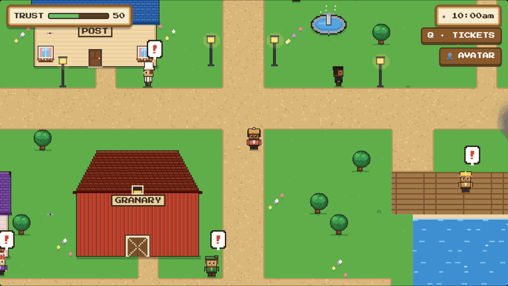
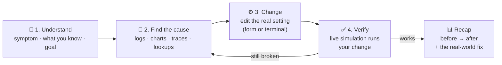
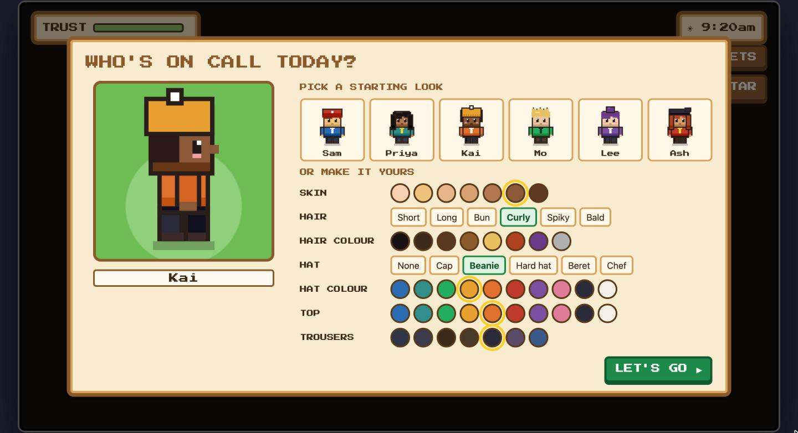
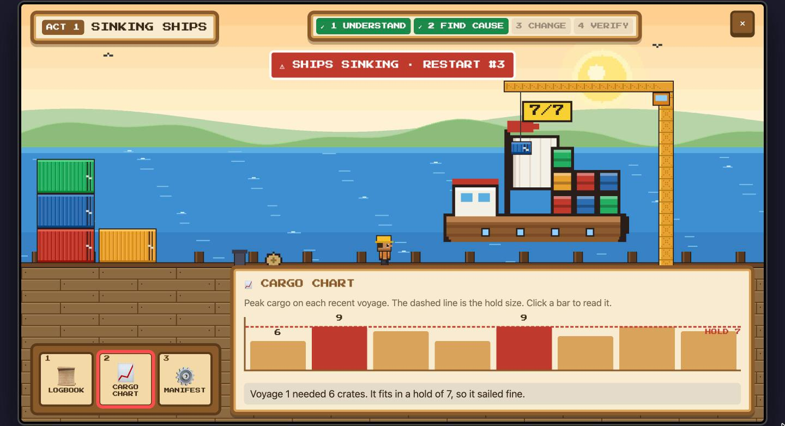
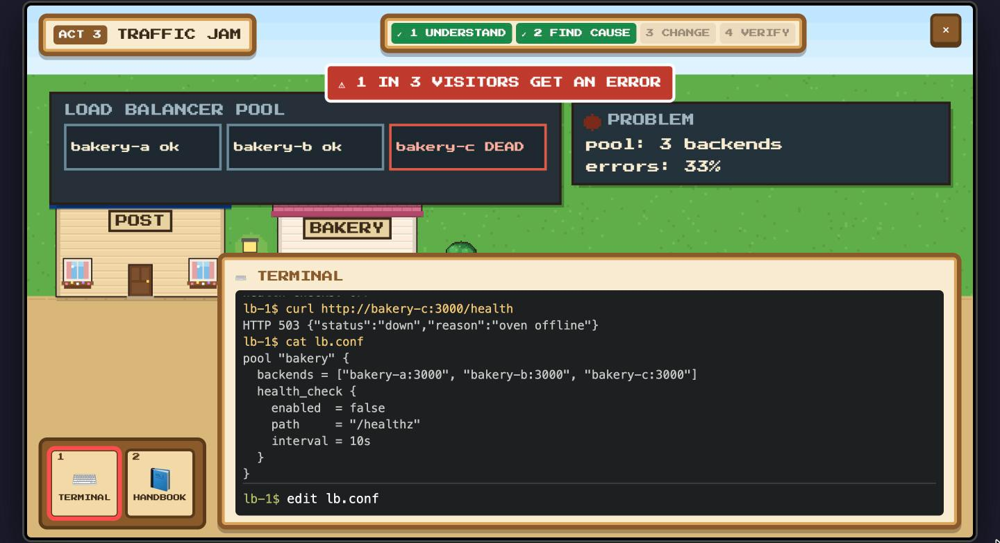
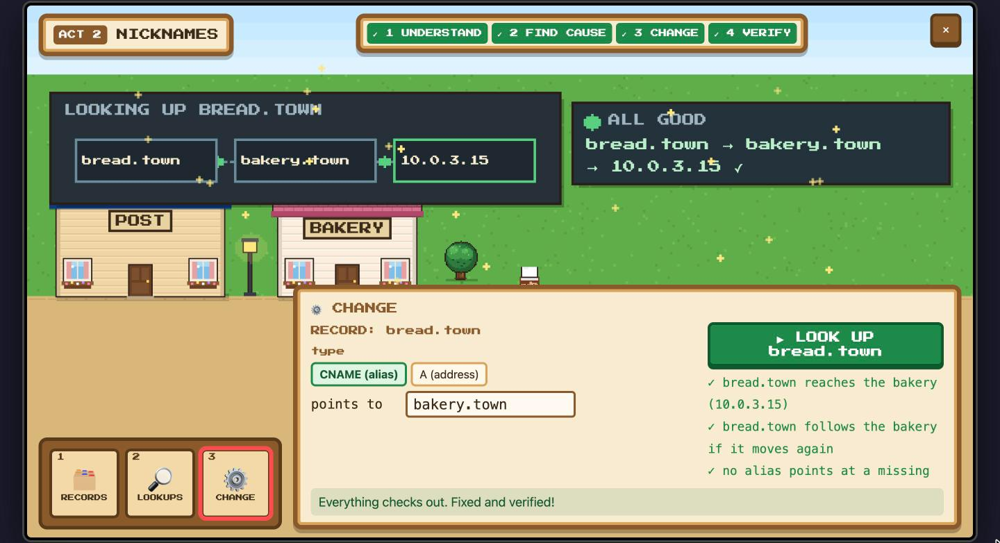
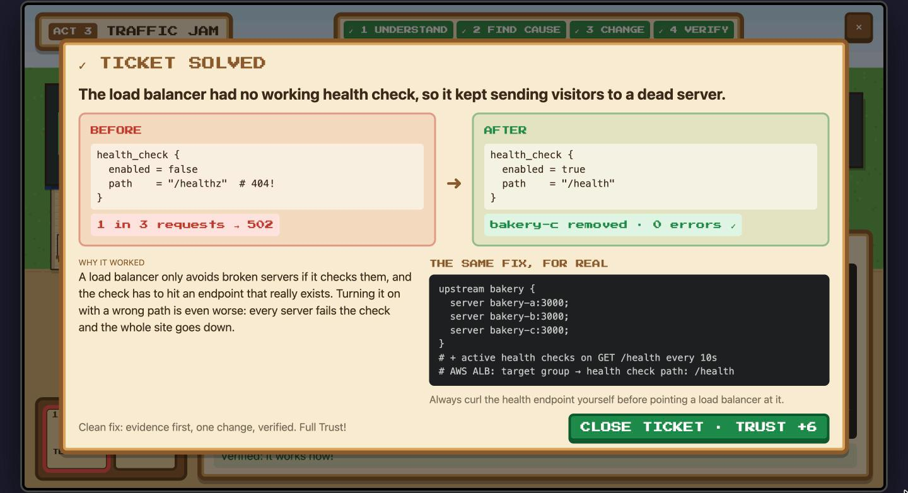
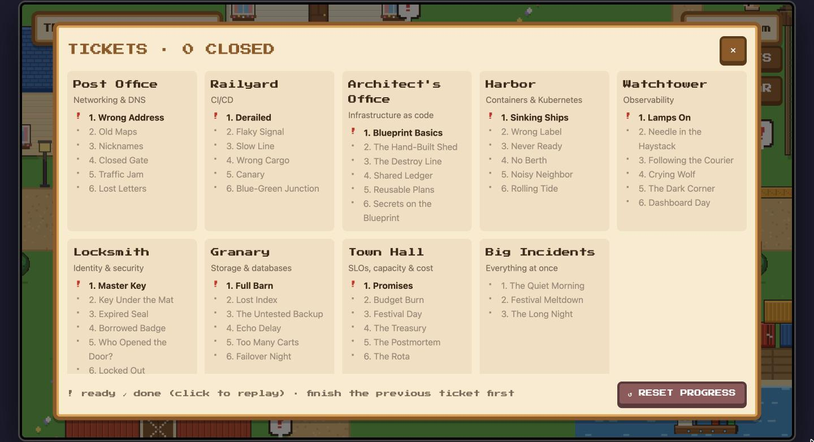
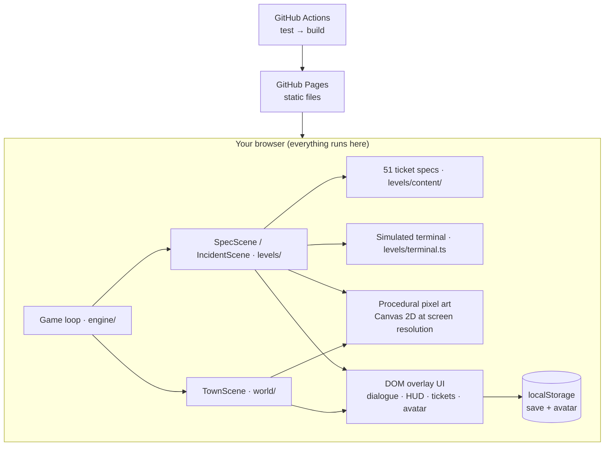

<div align="center">

# 🏘️ Ninefold

### Learn SRE, DevOps & cloud engineering by fixing a cozy pixel-art town

*Ships sink because they run out of memory. Letters go to the wrong house because a DNS record is wrong.<br>You investigate, change the real setting, verify it, then see the same fix for real.*

<a href="https://sharatvikas.github.io/ninefold/"></a>

[](https://github.com/sharatvikas/ninefold/actions/workflows/deploy.yml)


<a href="https://sharatvikas.github.io/ninefold/"></a>

<sub>↑ A real ticket, start to finish: walk the town → the build train has derailed → <b>find the cause</b> in the build log → <b>change</b> the parts list → <b>verify</b>: every station passes and the train leaves → before/after recap with the real <code>package.json</code> fix.</sub>

**[▶ Play now](https://sharatvikas.github.io/ninefold/)** · [Why Ninefold?](#-why-ninefold) · [How a ticket works](#-how-a-ticket-works) · [Screenshots](#-screenshots) · [All 51 tickets](#%EF%B8%8F-the-town-8-districts--51-tickets) · [Glossary](#-glossary) · [Run it locally](#-run-it-on-your-own-computer)

</div>

---

## 💡 Why Ninefold?

Reliability work (DevOps, Site Reliability Engineering, cloud and platform engineering) is mostly learned **on the job, during real outages, on real production systems**. That's stressful, risky, and hard to practise on purpose.

Ninefold is a safe place to practise. The town of Ninefold *is* a running system:

- every **district** is one area of the job (networking, CI/CD, Kubernetes, security and so on)
- every **townsperson** owns a service and hands you **tickets**
- every **problem** shows up as something you can *see*: sinking ships, letters at the wrong door, a derailed build train

You fix things the way an on-call engineer does: **gather evidence first, make one deliberate change, then prove it worked.** Guessing costs you Trust.

> **Named after "the nines"**: uptime is measured in nines (99.9% = "three nines"). Ninefold is a town that wants all nine.

**Who it's for:** students and career-switchers getting into DevOps/SRE · developers who want to understand ops · junior on-call engineers · interview prep · teams looking for a fun onboarding exercise.

---

## 🔁 How a ticket works

Every ticket follows the same four steps, tracked at the top of the screen:



| | What you do | Example (Sinking Ships) |
|---|---|---|
| **Understand** | Read the ticket: what users see, what's known, the goal | "Ships sink partway out; the harbor relaunches them" |
| **Find the cause** | Click the evidence that explains it: nothing tells you the answer | The log line `HOLD OVERFLOW · ship sank`; a cargo chart peaking at 9 crates |
| **Change** | Type your own values into the real setting. Watch out for red herrings | Set `hold_size` in the ship manifest (crew size is a decoy) |
| **Verify** | Your change runs live. Wrong values visibly fail | Three voyages sail; a hold of 8 still sinks on the 9-crate voyage |
| **Recap** | Before/after, why it worked, and the same fix with real tools | `resources.limits.memory: 448Mi → 640Mi` |

**Trust** is your reputation, and Ninefold's version of an *error budget*. A clean fix earns +6. You lose 1 for changing things before finding evidence, 1 for each change that didn't work, and 1 for an oversized fix.

### Three acts: from metaphor to the real thing

| Act | Tickets | How it feels | Example |
|---|---|---|---|
| **1 · Metaphor** | 1–2 in each district | Pure town logic, no jargon | Drag the bakery's sign to the right house |
| **2 · Bridge** | 3–4 | Same world, real names on everything | `bread.town CNAME bakery-old.town` → NXDOMAIN |
| **3 · Real tools** | 5–6 | A simulated terminal with real commands and files | `kubectl logs`, `dig`, `terraform plan`, PromQL, editing YAML |

---

## 📸 Screenshots

<table>
<tr>
<td width="50%"><br><b>The town.</b> Walk around and talk to anyone showing a <code>!</code>; smoke means an incident.</td>
<td width="50%"><br><b>Make your on-call engineer.</b> 6 presets plus skin, hair, hats, outfit and name.</td>
</tr>
<tr>
<td><br><b>Find the cause.</b> Read the cargo chart; the live gauge shows crates vs. hold size.</td>
<td><br><b>Act 3: real tools.</b> Curl the backends, read <code>lb.conf</code>, edit it, reload.</td>
</tr>
<tr>
<td><br><b>Verify.</b> Every check runs against your change; the diagram turns green.</td>
<td><br><b>Learn it.</b> Before → after, why it worked, and the same fix for real.</td>
</tr>
<tr>
<td colspan="2" align="center"><br><b>51 tickets across 8 districts</b>: press <kbd>Q</kbd> to see them all, replay any, or reset.</td>
</tr>
</table>

---

## 🗺️ The town: 8 districts · 51 tickets

Each district's NPC hands out six tickets, easiest first. Click a district to see every ticket and **what the concept means**.

<details>
<summary><b>📮 Post Office: Networking & DNS</b> (Rosa)</summary>

| # | Ticket | Concept | What it means |
|---|---|---|---|
| 1 | Wrong Address | **DNS A record** | DNS turns a name (`bakery.town`) into an IP address. An A record is one name → address line; if it's wrong, everyone goes to the wrong server. |
| 2 | Old Maps | **Caching & TTL** | Resolvers cache answers for the record's *time-to-live*. Lower the TTL *before* a migration or users keep the old address for days. |
| 3 | Nicknames | **CNAME** | An alias that points one name at another name. If the target is deleted, every alias to it breaks (NXDOMAIN). |
| 4 | Closed Gate | **Firewall / security group** | Rules that allow traffic by port and source. New ports are closed by default; open only what's needed, to only who needs it. |
| 5 | Traffic Jam | **Load balancer health checks** | A load balancer spreads requests over servers and should stop sending to unhealthy ones, but only if its health check hits a real endpoint. |
| 6 | Lost Letters | **Routing & traceroute** | Routers forward packets hop by hop using route tables. `traceroute` shows where packets stop; a stale next hop drops them. |
</details>

<details>
<summary><b>🚂 Railyard: CI/CD</b> (Ines)</summary>

| # | Ticket | Concept | What it means |
|---|---|---|---|
| 1 | Derailed | **Build logs & dependencies** | A build only has what's declared in the manifest. Code and its dependency list must change together. |
| 2 | Flaky Signal | **Flaky tests** | Tests that pass or fail at random, often due to fixed `sleep()`s. Wait for the condition instead; retries just hide it. |
| 3 | Slow Line | **Pipeline speed** | Make pipelines fast by caching dependencies, running independent jobs in parallel, and sharding the slowest stage. |
| 4 | Wrong Cargo | **Artifact versioning** | `latest` is whatever was pushed last. Deploy a pinned version or digest, and make release tags immutable. |
| 5 | Canary | **Canary releases** | Send a small slice of traffic to a new version first; compare its errors with the stable version and abort if worse. |
| 6 | Blue-Green Junction | **Blue-green deploys** | Run old (blue) and new (green) side by side, verify green, then switch traffic instantly, with an instant way back. |
</details>

<details>
<summary><b>📐 Architect's Office: Infrastructure as code</b> (Ada)</summary>

| # | Ticket | Concept | What it means |
|---|---|---|---|
| 1 | Blueprint Basics | **Plan before apply** | IaC makes reality match the code, including deleting what's missing. Read every `-` in the plan before applying. |
| 2 | The Hand-Built Shed | **Configuration drift** | Changes made by hand that the code doesn't know about. Import what you need; let the apply revert mistakes. |
| 3 | The Destroy Line | **Forced replacement** | Some attributes can't change in place, so `-/+` means destroy and recreate. Guard stateful resources with `prevent_destroy`. |
| 4 | Shared Ledger | **State locking** | IaC tracks what exists in a *state* file. Share it remotely, lock it during applies, and version it. |
| 5 | Reusable Plans | **Modules** | One reusable blueprint with inputs, so a fix reaches every copy instead of N copy-pastes drifting apart. |
| 6 | Secrets on the Blueprint | **Secrets in code** | A secret in git is leaked. Rotate it, then load secrets from a secret manager at deploy time. |
</details>

<details>
<summary><b>⚓ Harbor: Containers & Kubernetes</b> (Finn)</summary>

| # | Ticket | Concept | What it means |
|---|---|---|---|
| 1 | Sinking Ships | **OOMKilled / CrashLoopBackOff** | A container over its memory limit is killed; Kubernetes restarts it, and it dies again. Size limits from real peak usage. |
| 2 | Wrong Label | **ImagePullBackOff** | The node can't pull the container image: a typo'd tag, a missing image, or missing registry credentials. |
| 3 | Never Ready | **Readiness probes** | Kubernetes only sends traffic to pods whose readiness check passes. A wrong port or path keeps a healthy app out of service. |
| 4 | No Berth | **Pending pods & scheduling** | Pods are placed by their resource *requests*. A request bigger than any node means the pod waits forever. |
| 5 | Noisy Neighbor | **CPU limits** | Without a limit, one container can take every spare CPU on its node and starve the others. |
| 6 | Rolling Tide | **Rolling updates** | Updates replace pods a few at a time and pause if new ones aren't ready. The cause is usually in the new pod's logs. |
</details>

<details>
<summary><b>🗼 Watchtower: Observability</b> (Lin)</summary>

| # | Ticket | Concept | What it means |
|---|---|---|---|
| 1 | Lamps On | **Golden signals** | Latency, traffic, errors, saturation: the four measurements that tell you whether users are OK. |
| 2 | Needle in the Haystack | **Log search** | Filter logs by level and keyword instead of scrolling. The right error line usually contains the whole story. |
| 3 | Following the Courier | **Distributed tracing** | A trace shows one request's journey across services, so you can see which hop is slow (here: N+1 calls). |
| 4 | Crying Wolf | **Alert fatigue** | Page only on symptoms users feel, with a duration. Slow-burn causes become tickets, not 3 a.m. pages. |
| 5 | The Dark Corner | **Instrumentation** | You can't see what you don't count. Add counters to code and expose them on `/metrics`. |
| 6 | Dashboard Day | **PromQL & dashboards** | `rate()`, `sum()` and `histogram_quantile()` turn raw counters into availability and p95 latency. |
</details>

<details>
<summary><b>🔑 Locksmith: Identity & security</b> (Kit)</summary>

| # | Ticket | Concept | What it means |
|---|---|---|---|
| 1 | Master Key | **Least privilege** | Grant only the access that's actually used, based on evidence such as access logs. |
| 2 | Key Under the Mat | **Secret rotation** | A leaked credential can't be un-leaked: issue a new one and revoke the old one. |
| 3 | Expired Seal | **TLS certificates** | Certificates prove a site's identity and expire. Cover every hostname and automate renewal. |
| 4 | Borrowed Badge | **Temporary credentials** | Short-lived, scoped, per-person access (role sessions) instead of shared or permanent logins. |
| 5 | Who Opened the Door? | **Audit logs** | Records of who did what, when and from where. Use them to find and disable exactly the compromised key. |
| 6 | Locked Out | **Explicit deny** | In policy evaluation an explicit Deny beats any Allow. Fix the wrong membership, not the guardrail. |
</details>

<details>
<summary><b>🌾 Granary: Storage & databases</b> (Gus)</summary>

| # | Ticket | Concept | What it means |
|---|---|---|---|
| 1 | Full Barn | **Disk full & log rotation** | Things that grow forever (logs) fill disks. Find what's using space, then add retention. |
| 2 | Lost Index | **Database indexes** | Without an index a query scans every row. Index columns you filter on often; each index slows writes. |
| 3 | The Untested Backup | **Backups & restore drills** | Back up everything, keep a copy offsite, and test restores. A backup you can't restore isn't a backup. |
| 4 | Echo Delay | **Replication lag** | A replica must replay writes as fast as the primary takes them, or it falls further and further behind. |
| 5 | Too Many Carts | **Connection pools** | Total connections = app copies × pool size, and must fit the database limit. Scaling out multiplies it. |
| 6 | Failover Night | **Failover & split brain** | Promote the replica, fence the old primary so it can't accept writes, repoint the app, verify. |
</details>

<details>
<summary><b>🏛️ Town Hall: SLOs, capacity, cost & practice</b> (Mayor Bo)</summary>

| # | Ticket | Concept | What it means |
|---|---|---|---|
| 1 | Promises | **SLI & SLO** | An SLI measures what users experience (orders OK in < 2s); the SLO is the target (99.5% over 30 days). |
| 2 | Budget Burn | **Error budgets** | The gap between the SLO and 100% is a budget for mistakes. When it's nearly spent, slow down and fix reliability. |
| 3 | Festival Day | **Capacity & autoscaling** | Servers needed = peak ÷ per-server capacity at a CPU target that leaves headroom. |
| 4 | The Treasury | **Cost optimisation** | Cut idle, orphaned and oversized resources, but check each item's purpose before deleting. |
| 5 | The Postmortem | **Blameless postmortems** | Timeline, contributing factors and action items, focused on systems, not people. |
| 6 | The Rota | **Toil** | Repetitive manual work. The best automation removes the need for it (fix the cause), not just scripts it. |
</details>

<details>
<summary><b>🚨 Big Incidents: everything at once</b> (Chief Juno, unlocked per act)</summary>

| # | Incident | Concept | What it means |
|---|---|---|---|
| 1 | The Quiet Morning | **"What changed?"** | Line up when symptoms began with the change log; roll back the culprit and touch nothing else. |
| 2 | Festival Meltdown | **Cascading failure** | Autoscaling × connection pools × instant retries overwhelm a database. Size every hop and retry with backoff. |
| 3 | The Long Night | **Layered outage** | DNS, an expired certificate and a dead database at once. Work outside-in and verify after every fix. |
</details>

---

## 📖 Glossary

<details>
<summary><b>Quick definitions of the terms used in the game</b></summary>

| Term | Meaning |
|---|---|
| **SRE** (Site Reliability Engineering) | Running production systems with software-engineering practices: measure reliability, automate toil, learn from incidents. |
| **DevOps** | A culture and toolset where building and running software are one shared job. |
| **On-call** | Being the person who responds when systems break. |
| **Incident** | Any unplanned disruption to a service users rely on. |
| **SLI / SLO / SLA** | Indicator (what you measure) / Objective (your target) / Agreement (a contractual promise). |
| **Error budget** | 100% minus the SLO: how much unreliability you can "spend" on change. |
| **Uptime "nines"** | 99.9% = three nines ≈ 43 min down per month; 99.99% ≈ 4 min. |
| **MTTR** | Mean time to recovery: how fast you fix things. |
| **Postmortem** | A written, blameless review of an incident and what will change. |
| **Toil** | Manual, repetitive, automatable operational work. |
| **IaC** | Infrastructure as code: describing servers, networks and so on in versioned files (Terraform, CloudFormation). |
| **CI/CD** | Continuous integration (build & test every change) / continuous delivery (ship it safely and often). |
| **Container / Pod** | A packaged app with its dependencies / Kubernetes' smallest unit, one or more containers. |
| **Observability** | Understanding a system from its outputs: metrics, logs and traces. |
| **Least privilege** | Give every person and service only the access it needs. |
| **Rollback** | Returning to the last known-good version. |
</details>

---

## 💻 Run it on your own computer

Ninefold runs entirely in your browser. There's no server, database or account, so playing locally needs nothing beyond **Node.js**.

**1 · Install Node.js (one time):** version 20.19+ (22 LTS recommended) from [nodejs.org](https://nodejs.org), or `brew install node`, or `nvm install 22`. Check it with `node -v`.

**2 · Get the code**

```sh
git clone https://github.com/sharatvikas/ninefold.git
cd ninefold
```

No Git? Click **Code → Download ZIP** on GitHub, unzip it, and open a terminal in that folder.

**3 · Install and play**

```sh
npm install      # first time only, ~30 seconds
npm run play     # builds the game and opens http://localhost:4173
```

Stop it with <kbd>Ctrl</kbd>+<kbd>C</kbd>. Want to change the game? Use `npm run dev` (http://localhost:5173), which reloads instantly as you edit.

### 🎮 Controls

| Key | Action |
|---|---|
| <kbd>←</kbd><kbd>↑</kbd><kbd>↓</kbd><kbd>→</kbd> / <kbd>W</kbd><kbd>A</kbd><kbd>S</kbd><kbd>D</kbd> | Walk |
| <kbd>E</kbd> / <kbd>Space</kbd> | Talk, advance dialogue |
| <kbd>Q</kbd> | Ticket list: replay finished tickets, **⇄ Save code**, **↺ Reset progress** |
| <kbd>1</kbd>–<kbd>6</kbd> | Switch tools inside a ticket |
| <kbd>Esc</kbd> | Leave a ticket (press twice once you've started) |
| <kbd>Tab</kbd> + <kbd>Enter</kbd>/<kbd>Space</kbd> | Play entirely by keyboard |
| **👤 AVATAR** button | Change your look and name |
| Click the strips over a ticket's scene | Show or hide the ticket's diagram and status board. They tuck away by themselves once you've had time to read them, and pop back open when your fix is being checked. |

Touch screens get an on-screen pad. It's a wide-screen game, so on a phone, turn it sideways. A tablet or computer is best.

Found a ticket confusing or wrong? Every recap has a **💬 Tell me** link that opens a pre-filled issue for that ticket.

<details>
<summary><b>Saves, offline play & troubleshooting</b></summary>

- **Saves** live in your browser (localStorage), per web address. No account, nothing sent anywhere. Different browsers, private windows and different ports each have their own save. **Reset progress** (in <kbd>Q</kbd>) clears tickets and Trust but keeps your avatar.
- **Moving to another device:** <kbd>Q</kbd> → **⇄ Save code** gives you a code starting with `NF1-`. Paste it into Ninefold on the other browser or device to carry on there. The code holds only your closed tickets, Trust and avatar, and it never leaves your clipboard.
- **Offline:** after `npm install` the game works without internet; only the pixel font comes from Google Fonts (with a fallback).
- **Don't open `dist/index.html` directly.** Browsers block modules on `file://`; use `npm run play` or any static server (`npx serve dist`).

| Problem | Fix |
|---|---|
| `npm: command not found` | Install Node.js, then reopen the terminal |
| Errors mentioning `engine` | Node is too old: install 20.19+ or 22 LTS |
| `Port 4173 is in use` | `npx vite preview --port 4200` |
| Blank page | Hard-refresh (<kbd>Cmd/Ctrl</kbd>+<kbd>Shift</kbd>+<kbd>R</kbd>) and check the browser console |
</details>

### 🌐 Host your own copy for free

The build is ~300 KB of static files (≈100 KB compressed), with no server or database, so hosting can't run up a bill.

| Option | Cost | How |
|---|---|---|
| **GitHub Pages** *(used here)* | free | Fork, then *Settings → Pages → Source: GitHub Actions*. Every push runs the tests and redeploys. |
| **Cloudflare Pages** / **Netlify** | free plan | Build command `npm run build`, output folder `dist` |
| **itch.io** | free | Upload a ZIP of `dist/` as an HTML5 game |

### 📊 Play tracking (off unless you turn it on)

To learn where players get stuck, the game can count anonymous moments: a ticket opened, started, cause found, change made, a change that didn't work, solved (with a coarse time bucket like `2-5m`), or left unsolved (and at which step). There are no cookies, no player or session ids, and nothing about names, avatars or saves. **Do Not Track** and **Global Privacy Control** turn it off completely, and it never sends from `localhost`.

- **Off by default.** It only sends anywhere when the build has a [GoatCounter](https://www.goatcounter.com) site code. On GitHub Pages, add a repository variable `GOATCOUNTER_CODE` (*Settings → Secrets and variables → Actions → Variables*) holding the code, e.g. `ninefold` for `ninefold.goatcounter.com`, then redeploy. Locally: `VITE_GOATCOUNTER=ninefold npm run build`.
- **See what it would send:** open the game with `?analytics=debug` for a corner panel of recent events (kept only in your browser's localStorage); `?analytics=off` hides it and clears the log. The dev server shows the panel automatically.
- **In GoatCounter** each event is a path, so every ticket reads as a funnel: `ticket/harbor-1/open → /start → /cause → /fix → /solved/2-5m`, plus `/miss` and `/quit/at-<step>`. Replays of finished tickets go under `replay/…`.
- The code is in `src/analytics/`; another service is one small `Sink` away.

---

## 🛠️ Under the hood



- **Stack:** TypeScript + Vite + plain Canvas 2D (no game engine) + Vitest. No runtime dependencies.
- **Art:** every sprite, building and scene is drawn in code at your screen's real resolution, so it's sharp on any display.
- **Tickets are data.** Each one is a `LevelSpec`: evidence, the editable settings (or terminal files and commands), pure `verify`/`check` rules, a `solution`, and a recap.
- **339 tests.** Among other things, they prove that **every ticket starts broken and is solved by its intended fix**, that the town map is fully reachable, and that saves survive corrupted data.

<details>
<summary><b>Project layout & adding a ticket</b></summary>

```
src/
  engine/     game loop, input, scene switching
  art/        pixels, characters (32-grid), scenery, backdrops, ticket diagrams
  world/      town map, collision, TownScene
  levels/     catalog · IncidentScene · SpecScene · terminal engine
    content/  every ticket spec, by district (+ vignettes.ts diagrams)
    sims/     rules for the two hand-built tickets
  state/      progress, saves, avatar validation
  ui/         dialogue, HUD, ticket list, avatar creator
docs/         design spec, screenshots
```

To add a ticket: write a `LevelSpec` in `src/levels/content/<district>.ts`, add its diagram in `vignettes.ts`, and run `npm test`. The content tests check that it's solvable.

| Script | What it does |
|---|---|
| `npm run play` | Build and open the game at :4173 |
| `npm run dev` | Dev server with instant reload at :5173 |
| `npm test` | Run all tests |
| `npm run build` | Type-check and build to `dist/` |
</details>

---

<div align="center">

Built by **[Sarat](https://github.com/sharatvikas)**, Staff SRE, to make learning reliability engineering hands-on and fun.

**[▶ Play Ninefold](https://sharatvikas.github.io/ninefold/)**

</div>
